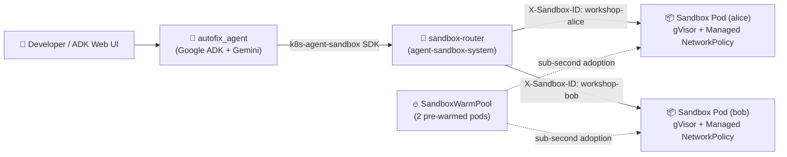

# Kubernetes Agent Sandbox on GKE — Autonomous Coding Agent Workshop

Run an autonomous **Google ADK** coding agent that claims pre-warmed, **gVisor-isolated** Kubernetes pods in milliseconds, executes untrusted Python code and unit tests safely, persists state across conversational turns, and enforces zero-trust network and kernel isolation on **GKE Autopilot**.



| Component | Kind / Package | Role in the Workshop |
|---|---|---|
| `workshop-template` | `SandboxTemplate` | Defines the gVisor pod spec, non-root security context (`uid=1000`), and `Managed` zero-trust `NetworkPolicy` |
| `workshop-warmpool` | `SandboxWarmPool` | Keeps 2 pre-warmed sandbox pods running so agent claims complete in milliseconds |
| `workshop-alice` / `workshop-bob` | `SandboxClaim` | Binds a tenant session to a dedicated warm pod (`adopt_existing=True` reconnects across turns) |
| `workshop.py` | Python CLI (`k8s-agent-sandbox`) | 4-command walkthrough (`seed`, `fix`, `check-security`, `cleanup`) |
| `autofix_agent/` | Google ADK Agent (`adk web`) | Interactive coding agent with 8 tools that autonomously diagnoses and patches 3 bugs inside the sandbox |

---

## Repo Layout

```text
agent-sandbox-gke/
├── manifests/
│   ├── 00-sandbox-router.yaml    # Router ServiceAccount, RBAC, Service & Deployment
│   ├── 00-namespace.yaml         # agent-sandbox-workshop namespace
│   ├── 01-sandboxtemplate.yaml   # Hardened gVisor SandboxTemplate + Managed NetworkPolicy
│   └── 02-sandboxwarmpool.yaml   # 2-replica SandboxWarmPool
├── autofix_agent/
│   ├── __init__.py
│   └── agent.py                  # Google ADK agent + 8 Agent Sandbox tools
├── workshop.py                   # Step-by-step Python SDK CLI (seed, fix, check-security, cleanup)
├── requirements.txt              # k8s-agent-sandbox, google-adk
├── setup-gke.sh                  # Provisions GKE Autopilot + controller + sandbox-router
└── teardown-gke.sh               # Tears down workshop namespace (or --full cluster delete)
```

---

## Pre-Workshop Setup (5 min)

Run [`setup-gke.sh`](setup-gke.sh) to create (or reuse) a GKE Autopilot cluster, install the Agent Sandbox controller (`v1.0.6`), and deploy `sandbox-router`:

```bash
./setup-gke.sh
```

Create a virtual environment and install the Python SDK and Google ADK:

```bash
python3 -m venv .venv
source .venv/bin/activate
pip install -r requirements.txt
```

---

## Step 1: Deploy the SandboxTemplate and SandboxWarmPool (5 min)

Apply [`manifests/01-sandboxtemplate.yaml`](manifests/01-sandboxtemplate.yaml) and [`manifests/02-sandboxwarmpool.yaml`](manifests/02-sandboxwarmpool.yaml) to pre-start 2 gVisor-isolated sandboxes:

```bash
kubectl apply -f manifests/01-sandboxtemplate.yaml
kubectl apply -f manifests/02-sandboxwarmpool.yaml

kubectl wait sandboxwarmpool/workshop-warmpool \
  -n agent-sandbox-workshop \
  --for=jsonpath='{.status.readyReplicas}'=2 --timeout=180s
```

In a second terminal, watch the pods in `agent-sandbox-workshop` so you can see claims and warm-pool refills happen in real time:

```bash
kubectl get pods,sandboxclaims -n agent-sandbox-workshop -w
```

---

## Step 2: Walk Through the Sandbox Lifecycle with the Python SDK (10 min)

Open [`workshop.py`](workshop.py) to see how `SandboxClient` claims a pre-warmed pod, writes files, runs commands, and reconnects across turns (`adopt_existing=True`).

1. **Seed a buggy e-commerce checkout module (`order_service.py`) and run its test suite (3 of 4 tests fail):**
   ```bash
   python3 workshop.py seed --tenant alice
   ```
   Notice in your `kubectl get pods -w` terminal that claiming `workshop-alice` immediately adopts one warm pod and triggers `workshop-warmpool` to spin up a replacement warm pod.

2. **Reconnect to `alice`'s existing sandbox (`adopt_existing=True`), patch all 3 bugs, and re-run the tests (all 4 pass):**
   ```bash
   python3 workshop.py fix --tenant alice
   ```

3. **Verify the security boundary (`gVisor` kernel, non-root user, and blocked GKE Metadata Server SSRF):**
   ```bash
   python3 workshop.py check-security --tenant alice
   ```

4. **Delete `alice`'s claim when finished:**
   ```bash
   python3 workshop.py cleanup --tenant alice
   ```

---

## Step 3: Drive It Live from Google ADK (`adk web`) (15 min)

The [`autofix_agent/agent.py`](autofix_agent/agent.py) module defines an autonomous Google ADK coding agent wired with 8 Agent Sandbox tools (`claim_sandbox`, `seed_buggy_project`, `list_sandbox_files`, `read_sandbox_file`, `write_sandbox_file`, `run_in_sandbox`, `check_sandbox_security`, and `delete_sandbox`). Every tool logs and returns the backing `sandbox_pod`, `container`, and `claim_latency_ms`.

1. Configure your Gemini backend (Vertex AI or Gemini API key) and start `adk web`:
   ```bash
   # Option A: Vertex AI
   export GOOGLE_GENAI_USE_VERTEXAI=TRUE
   export GOOGLE_CLOUD_PROJECT="$(gcloud config get-value project)"
   export GOOGLE_CLOUD_LOCATION="global"

   # Option B: Gemini API Key
   # export GOOGLE_API_KEY="YOUR_GEMINI_API_KEY"
   # export GOOGLE_GENAI_USE_VERTEXAI=FALSE

   adk web
   ```

2. Open **`http://127.0.0.1:8000`**, select **`autofix_agent`** in the top-left dropdown, and run these four prompts in order:

   - **Prompt 1 — Autonomous Bug-Fix Loop:**
     ```text
     Claim a sandbox for alice, seed the buggy project, run the unit tests in test_order_service.py, read order_service.py to fix all 3 bugs, and re-run the unit tests to confirm all 4 pass.
     ```

   - **Prompt 2 — Multi-Tenant Isolation (`alice` vs. `bob`):**
     ```text
     Claim a second sandbox for bob and list the files in both alice and bob's sandboxes to prove they are running on separate pods with isolated filesystems.
     ```

   - **Prompt 3 — Live Security & Containment Check:**
     ```text
     Check the security boundary of alice's sandbox.
     ```

   - **Prompt 4 — Clean Up Sandboxes:**
     ```text
     Delete both alice and bob's sandboxes.
     ```

---

## Teardown

```bash
./teardown-gke.sh          # Deletes the workshop namespace, keeps the GKE cluster
./teardown-gke.sh --full   # Deletes the router, controller, and GKE cluster
```

